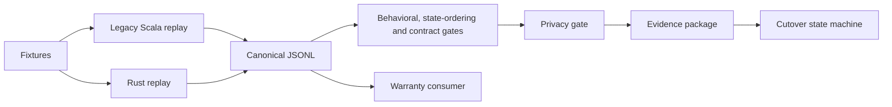
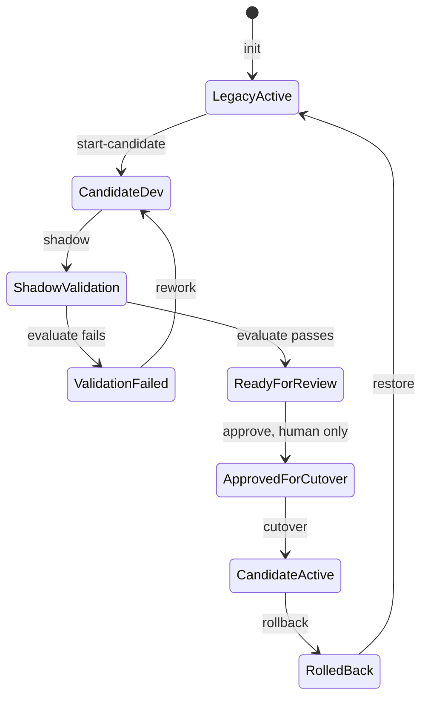

# Architecture

The demo uses synthetic event fixtures, two replay implementations, a
language-neutral JSONL comparison, verification gates, a review evidence
package and a local cutover simulator.

## Components and data flow

- `fixtures/scenarios/` contains fixed JSONL inputs and explicit scenario
  metadata. `fixtures/expected/` holds canonical summary and error outputs.
- `legacy-scala/` provides Scala replay without a cluster and an optional
  Spark Structured Streaming smoke path.
- `rust-processor/` provides Rust replay with an in-process keyed state
  store. Its Kafka feature is optional.
- `verification/runner.py` runs registered processors and records replay
  metadata. `verification/diff_harness/` compares parsed JSONL outputs.
- `consumer-warranty/` models the unchanged downstream consumer. The
  contract gate compares its state for baseline and candidate outputs.
- The privacy gate compares declared inventories and checks selected
  runtime outputs. The evidence package records run context, gates and file
  hashes.
- `verification/cutover/` shadows candidate output away from the topic-like
  JSONL file, then simulates a local lease handover and rollback.

Canonical JSONL means summaries and errors encoded as JSON Lines, then
parsed and normalized for comparison. Ordering across keys is not a
contractual output guarantee.

## Cutover state machine

The simulator requires all four gates, a matching run Git SHA and a clean
Git context before evaluation can reach `ReadyForReview`. Only a human may
approve. The local prompt is not a production authorization control.

State files include `state.json`, `lease.json`, `audit.jsonl` and
`topic.jsonl`. The lease is a single-host file lock with a fencing token.
Shadow outputs are isolated under the state directory. Handover is not
atomic, and per-key ordering and idempotent consumer upsert do not eliminate
gaps or all duplicate risks.

## Fast and integration tiers

The fast tier uses local replay and synthetic fixtures without Kafka or
Docker. Its four gates check behavior, state ordering, downstream contract
and privacy. The evidence package records the run and gate results.

The optional integration tier builds the Kafka-feature Rust service and
runs the 11 single-mode fixtures against fresh Redpanda topics. Input topics
have one partition because the watermark is global and cross-partition
interleaving can alter late-event outcomes. A schema-valid sentinel advances
the watermark past the fixture timestamps. The harness checks
`read_committed` outputs, transactional offsets, summary key-partition
affinity, and whether a second `serve` process reprocesses committed input.

The two restart-mode scenarios are explicitly skipped because dedupe,
watermark and open-session state are in memory. Durable state would need a
Kafka changelog in the same transaction. These checks exercise Kafka-to-Kafka
transactions on one Redpanda node. They do not prove end-to-end exactly-once
delivery, global ordering, durable restart recovery or production readiness.
Redpanda is a demo simplification.
